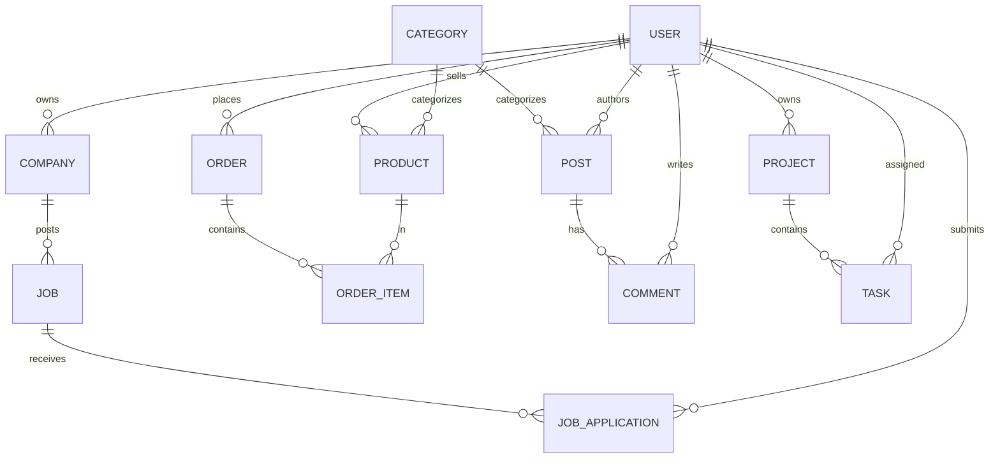

# WorkHub — Full-Stack Rails 8 Showcase Application

A production-grade, full-stack **Ruby on Rails 8** application that combines four real-world domains into one cohesive platform:

- 🧑‍💼 **Job Board** — Companies post jobs, freelancers apply
- 🛍️ **Marketplace** — Digital products with orders & order items
- 📝 **Blog / CMS** — Posts, categories, and comments
- 📋 **Project Management** — Projects with tasks, priorities, and progress tracking

Built to demonstrate **modern Rails architecture, authentication, authorization, testing, CI/CD, and production deployment** — ideal for interview preparation.

---

## ✨ Features

| Area | Details |
|------|---------|
| **Authentication** | Devise with role-based signup (Freelancer / Client / Admin) |
| **Authorization** | Pundit policies for fine-grained access control |
| **Search** | Ransack-powered search across jobs, products, and posts |
| **UI** | Tailwind CSS 4, Hotwire (Turbo + Stimulus), responsive design |
| **Database** | PostgreSQL with enums, scopes, and associations |
| **Testing** | Minitest model tests (23 tests, all passing) |
| **CI/CD** | GitHub Actions — security scans, linting, tests |
| **Deployment** | Docker, Kamal, AWS-ready configuration |

---

## 🚀 Quick Start (Local Development)

### Prerequisites

- Ruby 3.2.11 (via rbenv)
- PostgreSQL 14+
- Node.js (for asset pipeline)

### Setup

```bash
# 1. Install dependencies
bundle install

# 2. Configure database (defaults to local PostgreSQL)
#    Edit config/database.yml if needed

# 3. Create and migrate the database
bin/rails db:create db:migrate

# 4. Seed with demo data
bin/rails db:seed

# 5. Start the server
bin/dev
```

Visit **http://localhost:3000**

### Demo Accounts

| Role | Email | Password |
|------|-------|----------|
| Admin | `admin@workhub.dev` | `password123` |
| Client | `client@workhub.dev` | `password123` |
| Freelancer | `user@workhub.dev` | `password123` |

---

## 🏗️ Architecture

### Tech Stack

- **Framework**: Ruby on Rails 8.1
- **Language**: Ruby 3.2.11
- **Database**: PostgreSQL
- **Frontend**: Tailwind CSS, Hotwire (Turbo + Stimulus), Importmap
- **Auth**: Devise
- **Authorization**: Pundit
- **Search**: Ransack
- **Background jobs**: Solid Queue
- **Caching**: Solid Cache
- **WebSockets**: Solid Cable
- **Deployment**: Docker + Kamal

### Data Model



### Key Design Decisions

1. **Role-based access** — `User` has a `role` enum (`user`/`client`/`admin`) controlling what actions are permitted.
2. **Pundit policies** — Authorization logic lives in `app/policies/`, keeping controllers thin.
3. **Enums for state** — Jobs, orders, projects, and tasks use Rails enums for clear, type-safe statuses.
4. **Scopes for queries** — Common queries (published, recent, overdue) are encapsulated as model scopes.
5. **Ransack allowlisting** — Searchable attributes are explicitly allowlisted for security.

---

## 🧪 Testing

```bash
# Run the full test suite
bin/rails test

# Run a specific test file
bin/rails test test/models/job_test.rb

# Run RuboCop (style linting)
bin/rubocop

# Security scans
bin/brakeman --no-pager
bin/bundler-audit
```

---

## 🐳 Docker Deployment

### Build the image

```bash
docker build -t showcase_app .
```

### Run with Docker Compose (local)

```bash
docker compose up
```

### Deploy to AWS with Kamal

1. **Provision an EC2 instance** (Ubuntu 22.04, at least 2GB RAM)
2. **Configure `config/deploy.yml`** with your server IP and GitHub Container Registry credentials
3. **Set secrets** in `.kamal/secrets`:
   ```
   RAILS_MASTER_KEY=<your-production-key>
   DB_PASSWORD=<your-db-password>
   KAMAL_REGISTRY_PASSWORD=<github-token>
   ```
4. **Deploy**:
   ```bash
   bin/kamal setup   # First-time setup (installs Docker, creates DB)
   bin/kamal deploy  # Deploy the app
   ```

The app runs behind **Thruster** (HTTP/2 + asset caching) and uses a **PostgreSQL accessory** container.

---

## 📁 Project Structure

```
app/
├── controllers/        # MVC controllers
│   ├── admin/          # Admin namespace (dashboard, users, categories)
│   ├── jobs_controller.rb
│   ├── products_controller.rb
│   ├── posts_controller.rb
│   └── projects_controller.rb
├── models/             # ActiveRecord models with associations & scopes
├── policies/           # Pundit authorization policies
├── views/              # ERB templates (Tailwind-styled)
│   ├── shared/         # Navbar, footer partials
│   └── devise/         # Customized auth views
├── helpers/            # View helpers (badges, nav states)
└── javascript/         # Stimulus controllers
config/
├── routes.rb           # RESTful resource routing
├── database.yml        # PostgreSQL config (env-driven for production)
└── deploy.yml          # Kamal deployment config
db/
├── migrate/            # Schema migrations
└── seeds.rb            # Demo data
test/
├── models/             # Model tests
└── fixtures/           # Test fixtures
.github/workflows/      # GitHub Actions CI
```

---

## 🔒 Security

- **Devise** handles password hashing (bcrypt) and session management
- **Pundit** enforces authorization on every protected action
- **Ransack** attributes are allowlisted to prevent mass-assignment
- **Strong Parameters** used throughout controllers
- **Brakeman** and **bundler-audit** run in CI to catch vulnerabilities
- **Docker** runs as a non-root user for production

---

## 📚 Interview Talking Points

1. **Why Rails 8?** — Modern defaults (Solid Queue, Solid Cache, Kamal), importmap, and built-in production tooling.
2. **Authentication vs Authorization** — Devise handles *who you are*; Pundit handles *what you can do*.
3. **Database design** — Enums, associations, scopes, and indexes for performance.
4. **Testing strategy** — Model tests for business logic, CI for regression prevention.
5. **Deployment** — Containerized with Docker, orchestrated with Kamal, deployed to AWS EC2.
6. **Security** — Strong parameters, allowlisted search, non-root containers, security scanning.

---

## 📄 License

This project is for educational and interview-preparation purposes.

